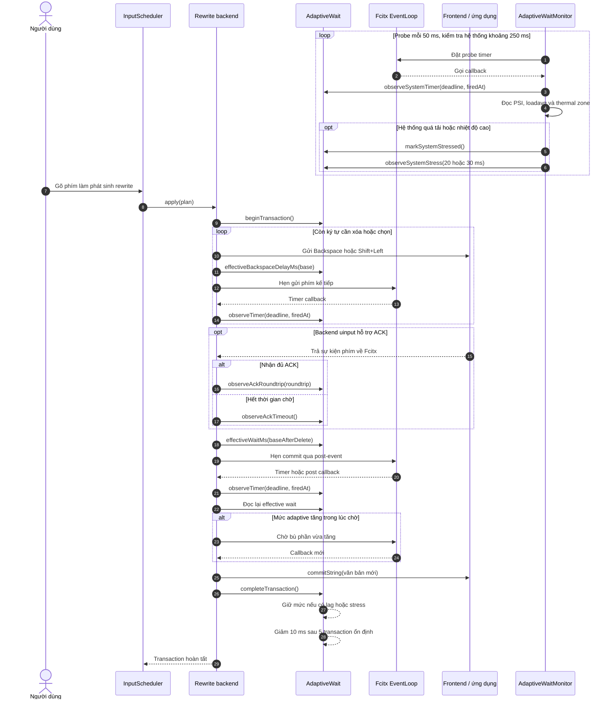

# Adaptive Delays trong ArecaIME

## Tổng quan

`AdaptiveWait` là cơ chế tự điều chỉnh thời gian chờ của các backend rewrite
trong ArecaIME. Mục đích của nó là giữ đúng thứ tự xử lý:

```text
xóa hoặc chọn văn bản → chờ ứng dụng xử lý → chèn văn bản mới
```

Khi máy hoạt động bình thường, ArecaIME dùng delay cơ bản trong cấu hình. Khi
phát hiện event loop phản hồi chậm, frontend trả ACK chậm, CPU quá tải hoặc nhiệt
độ cao, cơ chế tăng thời gian chờ trong giới hạn cho phép.

Khoảng chờ bổ sung giúp ứng dụng xử lý xong Backspace hoặc Shift+Left trước khi
`commitString()` chèn nội dung mới. Điều này giảm nguy cơ xóa thiếu, xóa thừa,
để lại chữ cũ hoặc chèn chữ mới sai vị trí khi hệ thống bị khựng.

Cơ chế dùng timer và post-task của Fcitx event loop. Nó không gọi `sleep` và
không khóa main thread.

## Các tín hiệu được theo dõi

| Tín hiệu | Cách đo | Ngưỡng | Kết quả |
|---|---|---:|---|
| Timer của transaction | `firedAtUsec - deadlineUsec` bằng đồng hồ monotonic | Từ 5.000 µs | Tăng thời gian chờ và ghi nhận transaction có lag |
| Event loop toàn cục | Probe mỗi 50.000 µs, accuracy 1.000 µs | Từ 5.000 µs | Cập nhật delay ngay cả khi chưa có transaction |
| ACK của `uinput` | Thời gian từ lúc phát xong chuỗi phím đến khi Fcitx nhận đủ sự kiện quay về | Từ 4.000 µs | Điều chỉnh theo round-trip thực tế |
| ACK timeout | Frontend không trả đủ ACK đúng hạn | Mỗi lần timeout | Đề nghị mức chờ 30 ms |
| Linux CPU PSI | `avg10` trong `/proc/pressure/cpu` | `>= 5`: cao; `>= 15`: nghiêm trọng | Đề nghị 20 hoặc 30 ms |
| System load | `load1` và runnable task trong `/proc/loadavg` | So sánh với số core logic | Đề nghị 20 hoặc 30 ms |
| Nhiệt độ CPU | Giá trị lớn nhất trong tối đa 16 thermal zone phù hợp | `>= 80°C`: nóng; `>= 85°C`: throttling | Kết hợp với CPU pressure để điều chỉnh |
| Transaction ổn định | Transaction hoàn tất mà không có lag | 5 lần liên tiếp | Giảm delay đã học đi 10 ms |

CPU pressure được coi là cao nếu PSI `avg10 >= 5`, số runnable task lớn hơn
hoặc bằng số core, hoặc `load1 >= 1,5 × số core`. Mức nghiêm trọng được xác định
khi PSI `avg10 >= 15`, runnable task lớn hơn hoặc bằng hai lần số core, hoặc
`load1 >= 2 × số core`.

`systemStressed` được bật khi tải nghiêm trọng, nhiệt độ đạt 85°C, hoặc CPU
pressure cao xảy ra cùng nhiệt độ từ 80°C. Mức đề nghị là 30 ms cho tải nghiêm
trọng hoặc throttling, và 20 ms cho pressure cao đi cùng nhiệt độ cao.

Probe event loop chạy mỗi 50 ms. PSI, load average và nhiệt độ được kiểm tra
khoảng mỗi 250 ms. Các giá trị chỉ tồn tại trong bộ nhớ tiến trình. Source hiện
không theo dõi RAM, I/O, pin, GPU hay tần số CPU.

## Cách tính thời gian chờ

Trạng thái chính là `extraWaitMs`:

- Khởi đầu ở `0 ms`.
- Tăng hoặc giảm theo bước `10 ms`.
- Có giá trị tối đa `50 ms`.
- Giảm một bước sau `5` transaction ổn định.

Khi nhận mẫu trễ `L` mili giây:

```text
L_clamped = min(50, L)
L_rounded = ceil(L_clamped / 10) × 10
extra_new = max(min(50, extra_old + 10), L_rounded)
```

Thuật toán tăng ít nhất 10 ms khi nhận tín hiệu lag mới, kể cả khi mức hiện tại
đã lớn hơn mẫu vừa đo. Ví dụ, `extra_old = 20 ms` và timer trễ 7 ms sẽ cho kết
quả mới là 30 ms.

Timer drift được đổi sang millisecond và làm tròn lên. ACK round-trip lấy phần
nguyên millisecond. ACK timeout truyền trực tiếp mức đề nghị 30 ms.

### Thời gian chờ trước commit

```text
effectiveWait(base) =
    base                         nếu base >= 50 ms
    min(50 ms, base + extra)     nếu base < 50 ms
```

Ví dụ, base 20 ms và `extraWaitMs` 50 ms cho kết quả 50 ms, tức phần thêm thực
tế là 30 ms. Nếu base từ 50 ms trở lên thì giá trị đó được giữ nguyên.

### Khoảng cách giữa các phím xóa hoặc chọn

```text
added = min(4, ceil(extra / 10))
effectiveKeyDelay = min(5 ms, baseKeyDelay + added)
```

Với base mặc định 1 ms, các mức `extraWaitMs` 0/10/20/30/40–50 ms tương ứng
delay giữa phím 1/2/3/4/5 ms.

Implementation hiện tại có một điểm cần lưu ý: khi `extraWaitMs > 0`, công thức
`min(5, ...)` có thể hạ `baseKeyDelay` lớn hơn 5 ms xuống còn 5 ms. Nếu cần hỗ
trợ base delay trên 5 ms, phần này nên được điều chỉnh.

## Sequence diagram



Trước khi commit, backend đọc lại mức adaptive. Nếu mức chờ tăng trong lúc timer
đang chạy, backend hẹn thêm phần chênh lệch rồi mới commit.

Sơ đồ thể hiện luồng tổng quát. Hai backend Shift+Select hiện không gọi
`observeTimer()` cho timer cục bộ giống nhóm Backspace; chúng vẫn dùng trạng
thái từ monitor toàn cục. `UinputShiftSelectBackend` còn cập nhật qua ACK.

## Phạm vi áp dụng

Một instance `AdaptiveWait` được `ArecaEngine` chia sẻ giữa các backend. Vì vậy,
thông tin về tình trạng chậm của hệ thống vẫn được giữ khi chuyển backend.

| Backend | Chờ trước commit | Giãn chuỗi phím/xóa | Đo timer cục bộ | Đo ACK |
|---|:---:|:---:|:---:|:---:|
| `SurroundingTextBackend` | Có | Không áp dụng | Có | Không |
| `SurroundingTextV2Backend` | Có | Có, giữa các lần xóa | Có | Không |
| `ForwardBackspaceBackend` | Có | Có | Có | Không |
| `UinputBackspaceBackend` | Có | Có | Có | Có |
| `UinputShiftSelectBackend` | Có | Không dùng adaptive giữa các phím Left | Không | Có |
| `XTestBackspaceBackend` | Có | Có | Có | Không |
| `XTestShiftSelectBackend` | Có | Có | Không | Không |

Tất cả backend vẫn nhận delay do monitor toàn cục cập nhật. Khác biệt trong bảng
chỉ thể hiện khả năng tự đo timer hoặc ACK của từng transaction.

`cancelTransaction()` kết thúc transaction và bỏ cờ lag của lượt đang chạy,
nhưng không xóa `extraWaitMs` đã học. Trạng thái hệ thống vì vậy tiếp tục được
dùng cho transaction sau.

## Lợi ích

- Giảm nguy cơ commit khi ứng dụng chưa xử lý xong thao tác xóa.
- Hạn chế xóa thiếu, xóa thừa hoặc chèn chữ sai vị trí khi máy khựng.
- Phản ứng với độ trễ event loop, ACK, tải CPU và nhiệt độ.
- Giữ trạng thái khi chuyển giữa các backend rewrite.
- Không khóa main thread.
- Tự giảm thời gian chờ khi hệ thống ổn định.

## Hạn chế và tác động

### Độ trễ khi gõ tăng

Tổng thời gian chờ trước commit có thể tăng tới 50 ms. Khoảng cách giữa các phím
ảo có thể tăng tới 5 ms mỗi phím. Với rewrite dài, các khoảng chờ giữa phím cộng
dồn và người dùng có thể cảm nhận được. Đây là sự đánh đổi giữa tốc độ phản hồi
và độ chính xác của thứ tự xử lý.

### Thời gian giảm lâu hơn thời gian tăng

Mỗi tín hiệu lag có thể tăng ít nhất 10 ms, trong khi cần 5 transaction ổn định
để giảm 10 ms. Khi `systemStressed` còn bật, quá trình giảm bị tạm dừng. Cách
làm này tránh delay thay đổi liên tục nhưng có thể giữ mức cao thêm một số
transaction sau khi hệ thống bắt đầu ổn định.

### Trạng thái dùng chung

Một ứng dụng hoặc backend chậm có thể làm backend khác cũng nhận delay bổ sung.
Trạng thái hiện không tách riêng theo process, frontend hoặc input context. Đổi
lại, cơ chế không phải học lại từ đầu khi backend fallback hoặc toàn hệ thống
đang quá tải.

### Chi phí theo dõi

Monitor duy trì timer 50 ms và đọc PSI, loadavg, thermal khoảng mỗi 250 ms.
Thermal zone chỉ được tìm một lần khi khởi tạo, giới hạn ở 16 zone và lọc theo
một số tên CPU phổ biến. Nếu hệ thống không cung cấp các interface này, timer
drift và ACK vẫn tiếp tục hoạt động.

### Không loại bỏ hoàn toàn lỗi do lag

Giới hạn 50 ms có thể không đủ nếu ứng dụng treo lâu. ACK chỉ có ở backend
uinput; pressure và nhiệt độ chỉ là chỉ báo. Adaptive Delays giảm xác suất race
condition nhưng vẫn cần phối hợp với surrounding-text probe, ACK timeout và cơ
chế fallback backend.

## Ví dụ hoạt động

Giả sử base wait sau Backspace là 3 ms và base delay giữa phím là 1 ms:

1. Máy bình thường, `extraWaitMs = 0`: phím cách nhau 1 ms, commit sau 3 ms.
2. Event loop trễ 13,903 ms: mẫu được làm tròn thành 20 ms, phím cách nhau 3 ms
   và commit sau 23 ms.
3. Transaction sau tiếp tục trễ 7 ms: mức tăng từ 20 lên 30 ms, phím cách nhau
   4 ms và commit sau 33 ms.
4. Sau 5 transaction không lag và không còn stress, mức giảm từ 30 xuống 20 ms.
5. Nếu nhiệt độ vẫn từ 85°C hoặc tải còn nghiêm trọng, mức chờ chưa được giảm.

## Các file liên quan

- Thuật toán và hằng số: `src/adaptive_wait.h`.
- Theo dõi event loop, PSI, load average và nhiệt độ:
  `src/adaptive_wait_monitor.h`, `src/adaptive_wait_monitor.cpp`.
- Khởi tạo trạng thái dùng chung: `src/areca_engine.h`, `src/areca_engine.cpp`.
- Các backend: `src/*backspace_backend.cpp`, `src/*shift_select_backend.cpp`,
  `src/surrounding_text_backend.cpp`, `src/surrounding_text_v2_backend.cpp`.
- Kiểm thử thuật toán: `tests/adaptive_wait_test.cpp`.
- Kiểm thử tích hợp: các file test của từng backend tương ứng.

## Kết luận

Adaptive Delays bảo vệ quá trình rewrite khi máy hoặc ứng dụng phản hồi chậm.
Cơ chế tăng một lượng nhỏ thời gian chờ để giữ đúng thứ tự xóa và chèn văn bản,
sau đó giảm dần thời gian bổ sung khi hệ thống ổn định trở lại.
