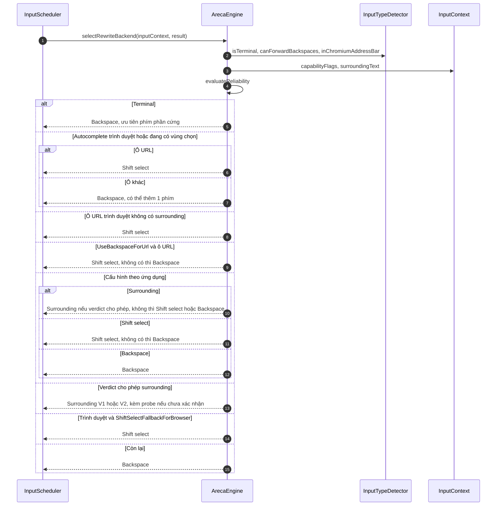
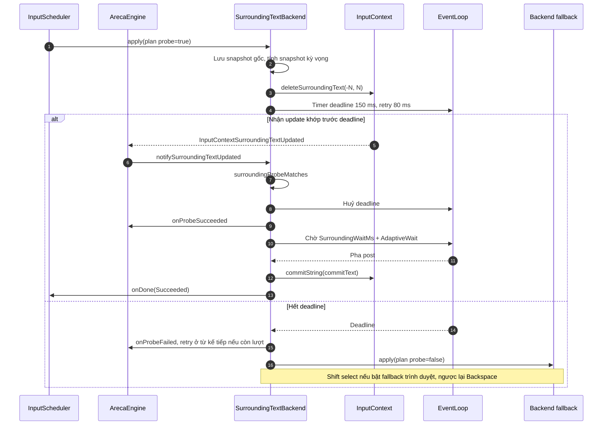
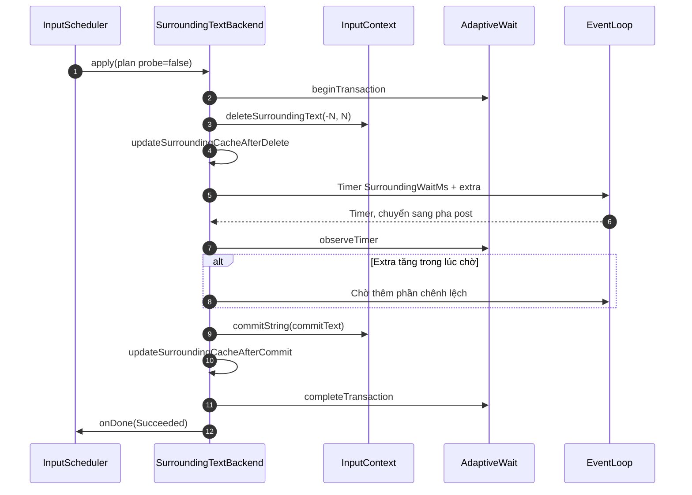
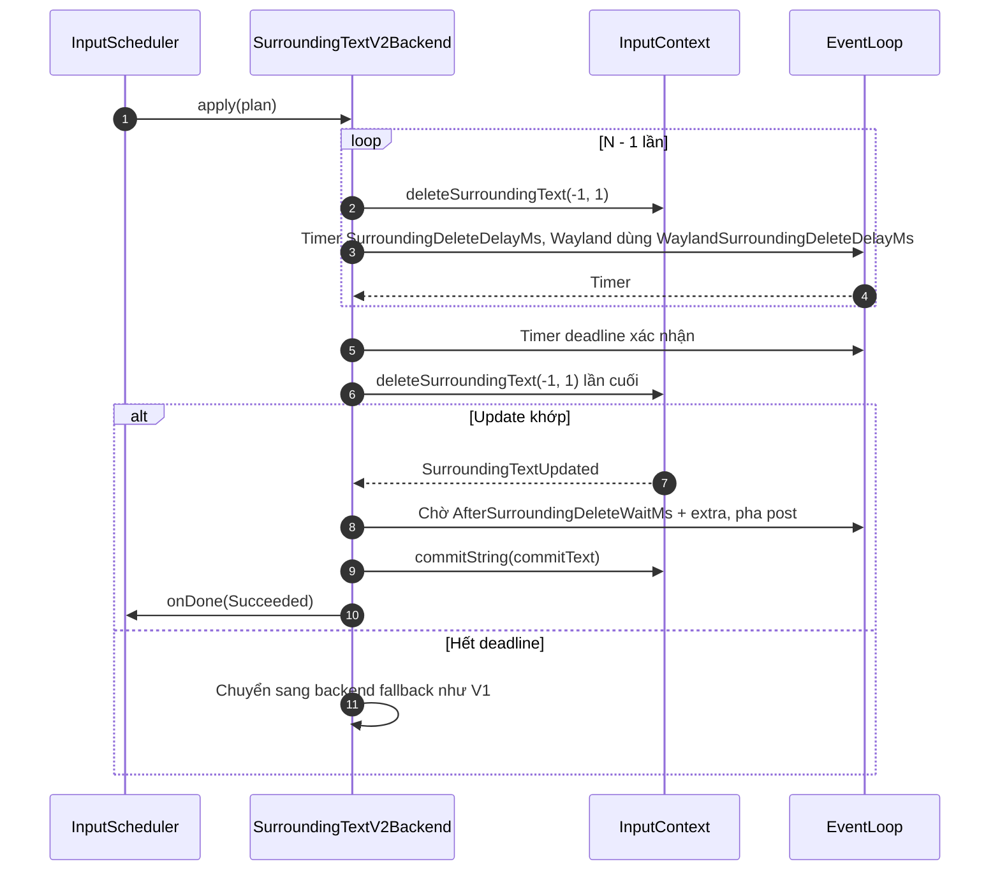
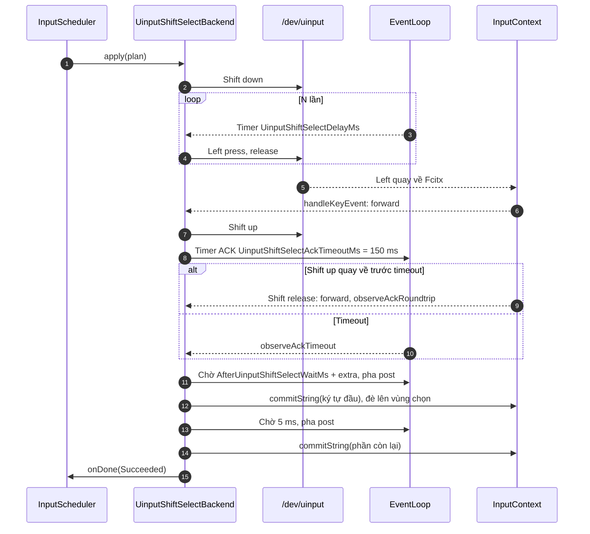
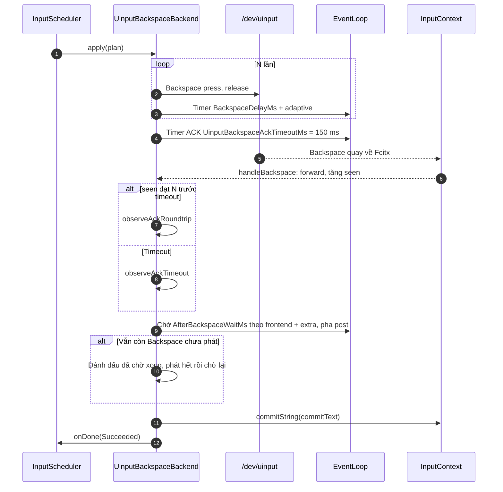
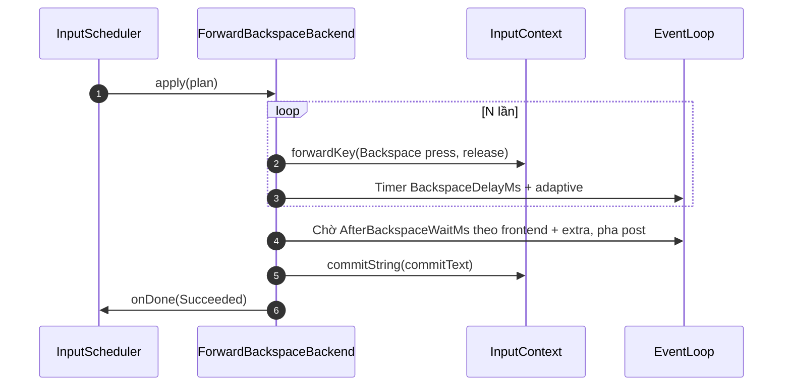

# Areca IME - Đặc tả kỹ thuật

Tài liệu đặc tả invariant, chính sách chọn backend, sequence diagram của từng
rewrite backend và bảng timing. Tổng quan thành phần, luồng phím, restore và
Preedit nằm trong [ARCHITECTURE.md](ARCHITECTURE.md).

## 1. Tổng quan luồng Rewrite

```text
Fcitx5 KeyEvent
   │
   ├─ ô mật khẩu, terminal bị tắt tiếng Việt, mode Redirect ─► forward nguyên bản
   ├─ phím do backend phát ra quay về ─► backend xử lý ACK và forward
   ├─ phím đầu trong trình duyệt, Bamboo rỗng ─► handleIdleKey
   │
   ▼ filterAndAccept
KeyQueue (FIFO) ─► InputScheduler (single-flight) ─► BambooEngineAdapter
                                                        │
                       deleteCount == 0 ◄───────────────┤
                       commitString                     │ deleteCount > 0
                                                        ▼
                                              selectRewriteBackend
                                                        │
      ┌──────────────────┬───────────────────┬──────────┴───────────┐
      ▼                  ▼                   ▼                      ▼
 Surrounding V1/V2   Shift select        Backspace             Backspace
 deleteSurrounding   uinput / Native     uinput / Native       ForwardKey
                                                        │
                                                        ▼
                                  AdaptiveWait → EventLoopPostTask → commitString
                                                        │
                                                        ▼
                                         PostCommitDelayMs → phím kế tiếp
```

## 2. Thành phần

| Thành phần | Trách nhiệm |
| :--- | :--- |
| `ArecaEngine` | Vòng đời addon, chọn mode theo ứng dụng, chọn backend, cache verdict surrounding của context hiện tại. |
| `RewriteModeHandler` | Policy phím Rewrite, restore surrounding, đưa phím vào scheduler. |
| `PreeditModeHandler` | Preedit đồng bộ, không dùng scheduler hay backend. |
| `RedirectModeHandler` | Forward phím gốc. |
| `InputScheduler` | FIFO single-flight, transaction rewrite, post-commit barrier, khoảng bảo vệ reset. |
| `BambooEngineAdapter` | Gọi `bamboo-core` qua cgo, trả `BambooResult` gồm `deleteCount` và `commitText`. |
| `BackendVerdict` | Kết quả probe surrounding, số lần probe, cờ retry ở từ kế tiếp. |
| `RewriteBackend` | Interface `apply(inputContext, plan, onDone)` trả `Completed`, `Pending` hoặc `Failed`. |
| `AdaptiveWait` | Thời gian chờ cộng thêm dùng chung cho mọi backend. |
| `EventLoopPostTask` | Chạy commit ở pha post của event loop. |

## 3. Invariant

1. **FIFO**: phím qua queue giữ đúng thứ tự. Phím đầu chỉ được xử lý trực tiếp
   khi scheduler rảnh và hết khoảng bảo vệ.
2. **Single-flight**: tại một thời điểm chỉ một phím được Bamboo xử lý và chỉ một
   transaction rewrite chạy.
3. **Transaction barrier**: khi backend đang xoá, chọn hoặc commit, scheduler giữ
   trạng thái bận. Sau khi backend báo hoàn tất, scheduler chờ thêm
   `PostCommitDelayMs`.
4. **Gọi lại đúng một lần**: backend trả `Pending` phải gọi `onDone` đúng một lần
   với đúng `transactionId`.
5. **Dừng khi lỗi**: backend báo `Failed` làm scheduler dừng nhận phím vì trạng
   thái ứng dụng không còn xác định.
6. **Không sleep trên thread chính**: mọi khoảng chờ dùng timer của event loop.
   Việc chặn như D-Bus đồng bộ chạy trên thread riêng.
7. **Không reset giữa transaction**: reset bị từ chối khi đang có rewrite hoặc
   trong 50 ms sau commit.

## 4. Chính sách chọn backend



Thứ tự trong từng nhóm backend:

| Nhóm | Thứ tự |
| --- | --- |
| Surrounding | V2 nếu `UseSurroundingV2InsteadOfSurroundingV1`, ngược lại V1 |
| Shift select | Native nếu `UseXTestInsteadOfUinput` → uinput → Native |
| Backspace | Nếu cần phím phần cứng hoặc `UseUinputInsteadOfForwardKey`: Native nếu được ưu tiên → uinput → Native. Cuối cùng ForwardKey |

Cần phím phần cứng khi ứng dụng là terminal hoặc `canForwardBackspaces()` trả
false: ứng dụng SDL, frontend DBus thiếu `KeyEventOrderFix` và `SurroundingText`,
frontend Fcitx4 thiếu `FormattedPreedit` và `SurroundingText`, hoặc frontend lạ.

> [!IMPORTANT]
> **Bảo vệ vùng chọn**: khi ô đang có vùng chọn hoặc gợi ý autocomplete, ô không
> phải URL dùng Backspace với 1 phím thêm để xoá vùng chọn trước. Ô URL dùng
> Shift select để chọn lại đúng phần cần thay.

## 5. Sequence diagram các backend

### 5.1. `SurroundingTextBackend`

#### A. Probe bằng `SurroundingTextUpdated`



Update không khớp bị bỏ qua và backend tiếp tục chờ. Ngoài ra, nếu ngay lúc
chọn backend snapshot không chứa từ đang gõ trước con trỏ, probe bị tính là thất
bại trước khi gửi lệnh xoá và restore bị tắt cho context đó.

#### B. Rewrite khi đã xác nhận



### 5.2. `SurroundingTextV2Backend`

Dùng cho editor xử lý lệnh xoá gộp `-N` không ổn định. Xoá từng ký tự và xác
nhận lần xoá cuối ở mọi rewrite, không chỉ lần đầu.



### 5.3. `UinputShiftSelectBackend`



Mọi Left và Shift quay về đều được forward tới ứng dụng. Shift up là ACK duy nhất.
`commitText` rỗng thì backend phát một Backspace để xoá vùng chọn.

### 5.4. `NativeShiftSelectBackend`

Giống 5.3 nhưng phát Shift, Left qua libei, khoảng cách giữa các Left
cộng thêm adaptive, và không chờ ACK: thả Shift xong là bắt đầu chờ commit.

### 5.5. `UinputBackspaceBackend`



Mọi Backspace quay về đều được forward. `seen` chỉ là mốc để bắt đầu chờ, không
dùng để lọc phím. Commit không bao giờ xảy ra trước khi phát hết N phím.

### 5.6. `NativeBackspaceBackend`

Phát Backspace × N qua libei với `XTestBackspaceDelayMs` cộng adaptive,
rồi chờ `AfterXTestBackspaceWaitMs` theo frontend cộng extra và commit ở pha post.
Không có ACK.

### 5.7. `ForwardBackspaceBackend`



## 6. Timing

Các khoá nằm trong `conf/areca-advanced.conf`. Khoá có hậu tố frontend được chọn
theo tên frontend bắt đầu bằng `wayland`, `xim`, `fcitx4`, `dbus`, `ibus`. Khoá
ẩn không có trong giao diện nhưng đọc được từ file.

| Khoá | Ý nghĩa | Mặc định |
| :--- | :--- | :--- |
| `BackspaceDelayMs` | Giữa các Backspace uinput và ForwardKey | 1 ms |
| `UinputBackspaceAckTimeoutMs` | Timeout ACK Backspace uinput, ẩn | 150 ms |
| `AfterBackspaceWaitMs` | Chờ sau Backspace cuối, frontend khác | 10 ms |
| `Wayland`, `Xim`, `Fcitx4`, `Dbus`, `IBus` + `AfterBackspaceWaitMs` | Như trên theo frontend | 10 ms |
| `UinputShiftSelectDelayMs` | Giữa các Left, dùng cho cả Native | 1 ms |
| `UinputShiftSelectAckTimeoutMs` | Timeout ACK Shift up, ẩn | 150 ms |
| `AfterUinputShiftSelectWaitMs` | Chờ sau khi thả Shift, frontend khác | 10 ms |
| `WaylandAfterUinputShiftSelectWaitMs` | Như trên, Wayland | 5 ms |
| `Xim`, `Fcitx4`, `Dbus`, `IBus` + `AfterUinputShiftSelectWaitMs` | Như trên theo frontend | 10 ms |
| `SurroundingWaitMs` | Chờ sau lệnh xoá surrounding V1 | 3 ms |
| `SurroundingProbeTimeoutMs` | Timeout probe chung, ẩn. Probe tự động dùng 150 ms rồi 80 ms | 80 ms |
| `SurroundingDeleteDelayMs` | Giữa các lệnh xoá V2 | 10 ms |
| `WaylandSurroundingDeleteDelayMs` | Như trên, Wayland | 0 ms |
| `AfterSurroundingDeleteWaitMs` | Chờ sau lệnh xoá V2 cuối | 1 ms |
| `XTestBackspaceDelayMs` | Giữa các Backspace Native | 1 ms |
| `AfterXTestBackspaceWaitMs` | Chờ sau Backspace Native cuối, frontend khác | 10 ms |
| `Wayland`, `Xim`, `Fcitx4`, `Dbus`, `IBus` + `AfterXTestBackspaceWaitMs` | Như trên theo frontend | 10 ms |
| `PostCommitDelayMs` | Barrier sau mỗi phím | 20 ms |
| `PreciseTiming` | Timer accuracy 1 µs thay vì 0 | `True` |

Preset hiệu năng trong ứng dụng cài đặt ImGui cũ đặt:

| Nhóm khoá | Giá trị |
| --- | --- |
| Chờ sau Backspace, Shift select, Native trên Wayland | 3 ms |
| Chờ sau Backspace, Shift select, Native trên DBus và IBus | 5 ms |
| `SurroundingWaitMs`, các delay và chờ của Surrounding V2 | 1 ms |

## 7. Tuỳ chọn hành vi liên quan

| Khoá | File | Mặc định | Tác dụng |
| --- | --- | --- | --- |
| `UseSurroundingV2InsteadOfSurroundingV1` | advanced | `False` | Dùng V2 cho nhóm Surrounding |
| `UseUinputInsteadOfForwardKey` | advanced | `True` | Nhóm Backspace ưu tiên phím phần cứng ở mọi ứng dụng |
| `UseXTestInsteadOfUinput` | advanced | `False` | Ưu tiên Native trước uinput |
| `EnableMouseTracking` | advanced | `True` | Chạy helper chuột để reset khi click |
| `ForwardFirstCharacter` | advanced | `True` | Bật nhánh phím đầu cho trình duyệt |
| `ShiftSelectFallbackForBrowser` | areca | `False` | Trình duyệt không dùng được surrounding thì dùng Shift select |
| `UseBackspaceForUrl` | areca | `True` | Xử lý riêng ô URL bằng Shift select |
| `RestoreSurroundingText` | areca | `False` | Sửa từ đã commit |
| `DisableVietnameseInTerminal` | areca | `False` | Forward nguyên phím trong terminal |
| `SelectBackendKey` | areca | phím dấu huyền | Mở menu chọn mode, backend cho ứng dụng |
